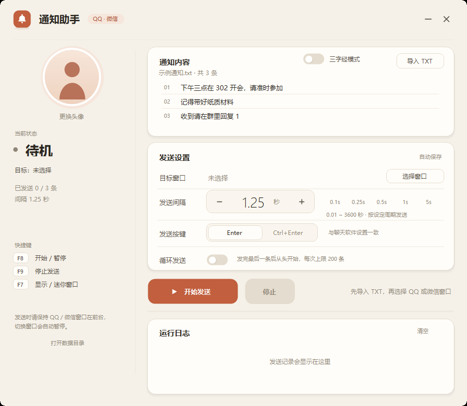
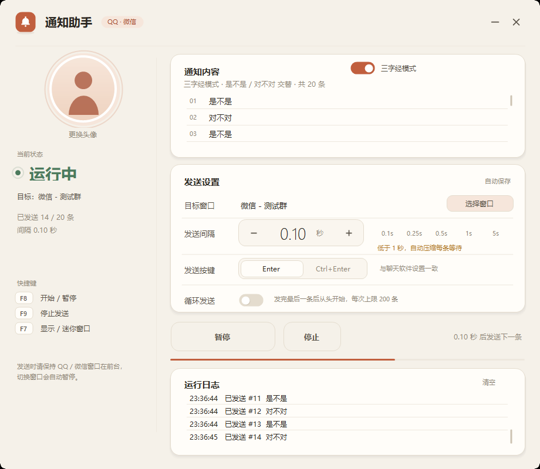

# 通知助手（QQ / 微信）

> 一个本地运行的 Windows 小工具：把 TXT 通知 / 三字经词汇，按你设置的间隔发送到选定的 QQ 或微信聊天窗口。
> 不是 bot、不登录协议、不需要服务器，工具本身不联网。




## 功能

- **QQ / 微信**：目标窗口支持 `QQ.exe`、`QQNT.exe`、`WeChat.exe`、`Weixin.exe`；
- **TXT 通知**：一行一条，UTF-8 / UTF-16 / GBK 自动识别；
- **三字经模式**：内置 20 条「是不是 / 对不对」交替词汇；
- **间隔可调**：`0.01 ~ 3600 秒`，两位小数，点击数字直接输入；
- **发送节奏**：间隔 = 两条消息开始发送之间的周期；低于 1 秒自动压缩等待；
- **安全**：目标窗口前台校验、失焦暂停、单次 200 条、单条 500 字、`@全体成员` / `@所有人` 拦截；
- **界面**：暖白纸感 UI、动画、圆形迷你窗、自定义头像、运行日志；
- **数据目录**：`%LOCALAPPDATA%\通知助手`，不在 exe（桌面）旁边生成文件。



## 下载 / 运行

1. 下载 [`release/通知助手.exe`](release/通知助手.exe)；
2. 双击运行（Windows 10/11，需要 .NET Framework 4.8.1，系统自带）；
3. 导入 TXT 或打开三字经模式；
4. 点「选择窗口」，5 秒内切换到 QQ / 微信聊天窗口；
5. 设置间隔，点「开始发送」或按 `F8`。

发布文件校验值见 [`release/SHA256.txt`](release/SHA256.txt)。

## 使用说明

- 发送时 QQ / 微信必须保持**前台**，切走会自动暂停；
- `F8` 开始 / 暂停 / 继续，`F9` 停止，`F7` 切换迷你窗口；
- 低于 1 秒时自动压缩发送流程；1 秒及以上正常恢复剪贴板；
- 间隔设置是唯一节奏来源，没有“极速模式”之类的开关。

### 数据位置

```text
%LOCALAPPDATA%\通知助手\
├─ settings.ini
├─ data\avatar.png
└─ logs\yyyy-MM-dd.log
```

主界面左下角有「打开数据目录」按钮。旧版放在 exe 旁边的 `settings.ini`、`data`、`logs` 会在首次运行新版时自动迁移。

## 构建

不需要 Visual Studio / .NET SDK / Node，Windows 自带 .NET Framework 编译器即可：

```bat
build.cmd
```

产物为 `dist\QQNotify.exe`（约 75 KB）。

也可以手动执行：

```bat
"%WINDIR%\Microsoft.NET\Framework64\v4.0.30319\csc.exe" /nologo /target:winexe /optimize+ /codepage:65001 ^
  /r:System.dll /r:System.Core.dll /r:System.Drawing.dll /r:System.Windows.Forms.dll ^
  /win32manifest:app.manifest /win32icon:app.ico ^
  /out:dist\QQNotify.exe src\*.cs
```

GitHub Actions 配置见 `.github/workflows/build.yml`，每次 push 会编译并上传构建产物。

## 项目结构

```text
notice-helper/
├─ src/                    C# 源码
├─ docs/PLAN.md            设计与实现说明
├─ screenshots/            界面截图
├─ release/                预编译 exe + 校验值
├─ 示例通知.txt
├─ settings.example.ini
├─ app.ico
├─ app.manifest
├─ build.cmd
├─ CHANGELOG.md
└─ LICENSE
```

设计与实现说明见 [docs/PLAN.md](docs/PLAN.md)，版本变化见 [CHANGELOG.md](CHANGELOG.md)。

## 已知限制

- 只能前台发送；锁屏、睡眠、窗口最小化会暂停；
- 只支持单个目标窗口；无发送回执；
- 无法识别同一聊天窗口内切换群/联系人；
- 低于 1 秒时可能因目标软件处理不过来而漏发/乱序；
- 单次 200 条、单条 500 字是刻意限制，防止误操作刷屏；
- 自动化操作本人账号有平台风控/封号风险。

## 免责声明

本项目与腾讯公司无关，不是 QQ / 微信官方产品。

仅供个人学习与自用。请只在你本人管理的群、或已明确同意的场景使用；不要用于群发广告、刷屏骚扰或任何违法用途。使用本工具产生的账号风险与内容责任由使用者自行承担。

## License

[MIT](LICENSE)
